# Router Training Results (with figures)

Router version `lgbm-20261027-154445`, τ_small = 0.65, τ_medium = 0.90. **Mock mode** (`MOCK_LLM=1`).
Every figure is regenerated by `MOCK_LLM=1 python docs/figures/make_figures.py` (needs matplotlib).

---

## 0. Training pipeline

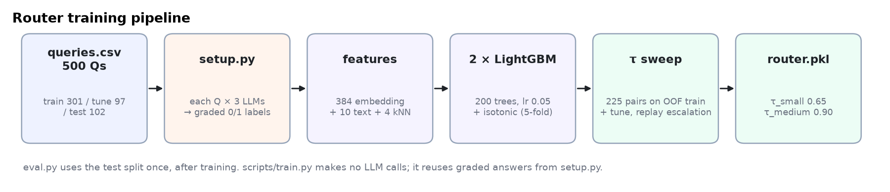

**Say:** "We grade every question on all three LLMs once, then train two calibrated LightGBM classifiers
on those labels, tune τ on held-out predictions, and save router.pkl. Training itself makes no LLM calls."

---

## 1. Data

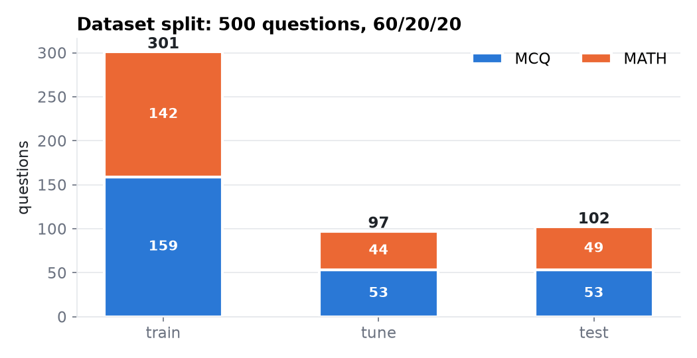

| Split | Questions | MCQ | Math | Used for |
|---|---|---|---|---|
| train | 301 | 159 | 142 | fit the trees and calibration |
| tune | 97 | 53 | 44 | choose τ (with out-of-fold train) |
| test | 102 | 53 | 49 | final evaluation, used once |

---

## 2. Labels: how often each LLM is right

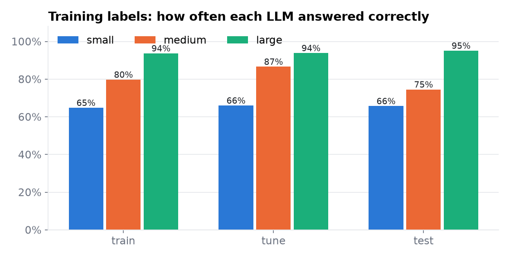

| | small | medium | large |
|---|---|---|---|
| train | 65% | 80% | 94% |
| tune | 66% | 87% | 94% |
| test | 66% | 75% | 95% |

**Say:** "Small already gets about two thirds right. The router's job is to find which two thirds."

---

## 3. Classifier quality (AUC)

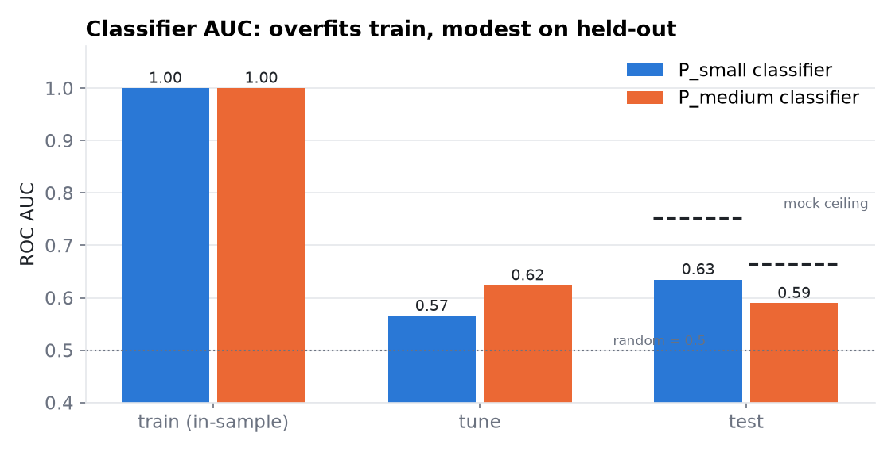

| Split | P_small AUC | P_medium AUC | P_small Brier | P_medium Brier |
|---|---|---|---|---|
| train (in-sample) | 1.000 | 1.000 | 0.021 | 0.066 |
| tune | 0.565 | 0.624 | 0.221 | 0.123 |
| **test** | **0.635** | **0.590** | **0.213** | **0.195** |
| best possible on test (mock) | 0.752 | 0.664 | | |

**Say:** "Train AUC 1.0 means the trees memorise training data, which is why τ is never tuned on train
scores. On test we reach 0.64, against a ceiling of 0.75. The mock answers are partly random, so no
router can do much better on this data."

---

## 4. Calibration

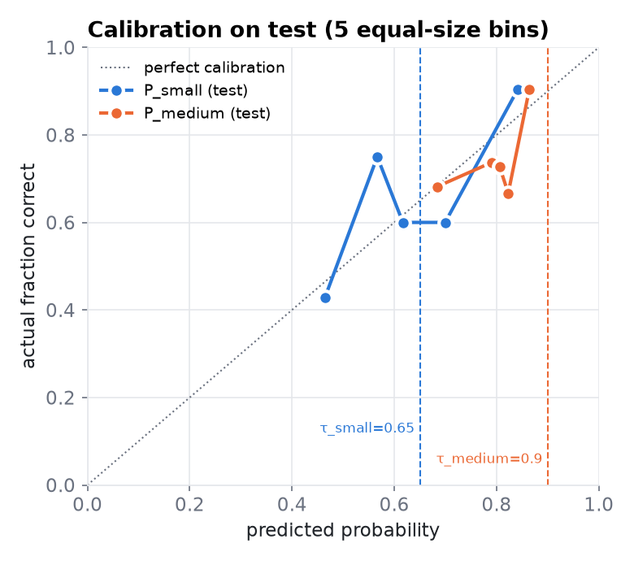

The points sit around the diagonal: when the router says ~0.85, small is right ~90% of the time.
The curve is bumpy because each bin has only ~20 test questions.

**Say:** "Isotonic calibration is what makes τ = 0.65 mean '65% likely correct'."

---

## 5. τ sweep

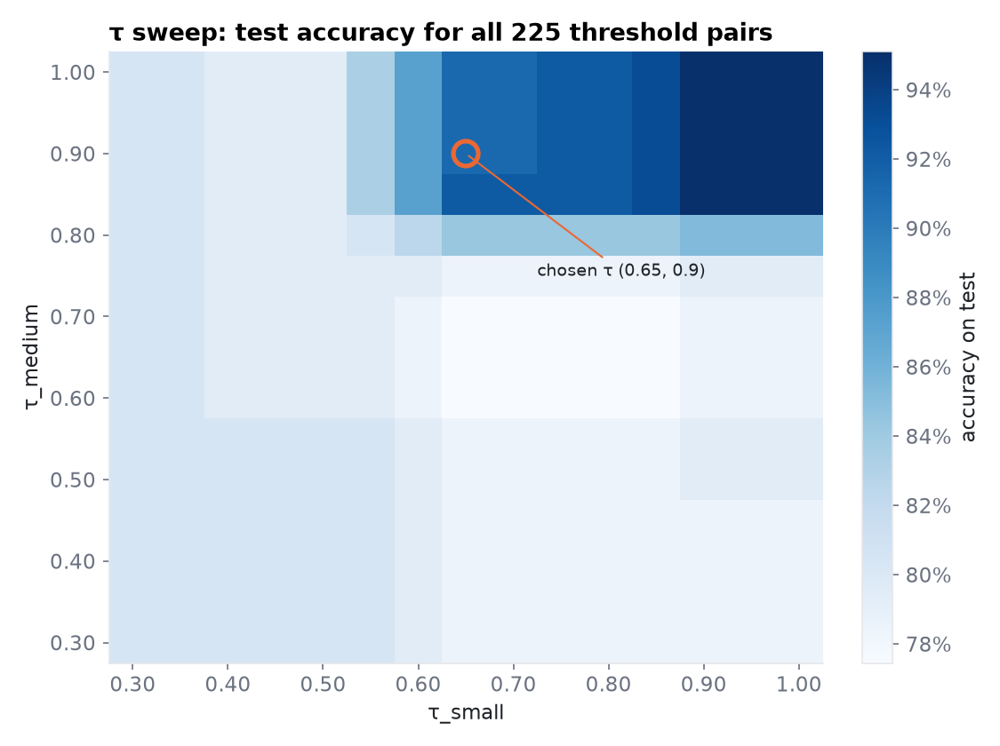

All 225 (τ_small, τ_medium) pairs, scored on test by `eval.py`. Dark = high accuracy. The chosen pair
(0.65, 0.90) was picked on train + tune **before** looking at test. It still lands in the high-accuracy
region, so the tuning generalised.

Note the sharp edge at τ_medium ≈ 0.85: below it, too many hard questions go to medium and accuracy
drops to ~80%. That's why the sweep chose a high τ_medium.

---

## 6. Cost vs accuracy

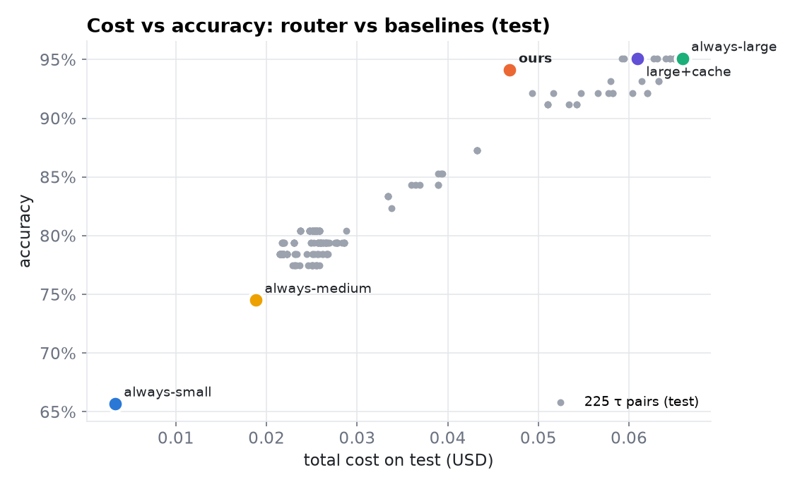

**Say:** "Every grey dot is a different τ setting. Ours sits near the top-left edge: almost
always-large accuracy for about 30% less money."

---

## 7. Final comparison (test, 102 questions)

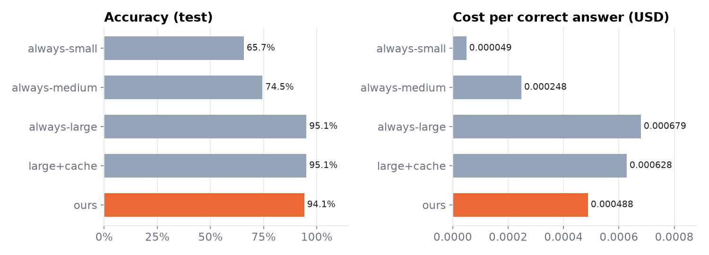

| Strategy | Accuracy | Cost per correct | Savings vs always-large | Avg latency |
|---|---|---|---|---|
| always-small | 65.7% | 0.000049 | 95.0% | 296 ms |
| always-medium | 74.5% | 0.000248 | 71.4% | 929 ms |
| always-large | 95.1% | 0.000679 | 0% | 2629 ms |
| large + cache | 95.1% | 0.000628 | 7.6% | 2463 ms |
| **ours** | **94.1%** | **0.000488** | **28.9%** | **1924 ms** |

---

## 8. Routing mix

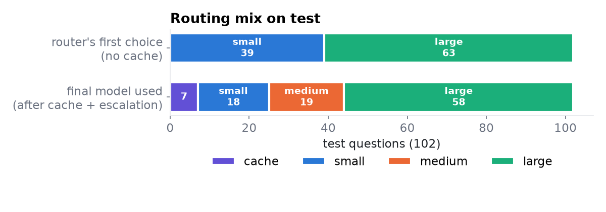

- **First choice (router only):** 39 small, 0 medium, 63 large.
- **Final model used:** 7 cache, 18 small, 19 medium, 58 large.
- 19 questions were escalated once (small unsure → medium). None needed 2 jumps.

**Say:** "Medium is never the first choice, because τ_medium is 0.90. It's reached through escalation,
when the small model's three samples disagree."

---

## 9. What the trees actually use

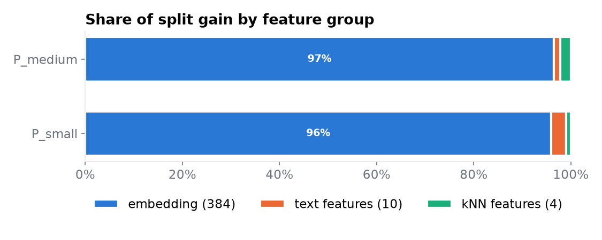

| | Embedding (384) | Text features (10) | kNN features (4) |
|---|---|---|---|
| P_small | 96% | 3% | 1% |
| P_medium | 97% | 1% | 2% |

**Weak spot, admit it if asked:** almost all the splits use embedding dimensions, and with 384 of them
against 301 rows, that's where the overfitting comes from. Next fix: shrink the embedding (e.g. PCA to
~32 dims) so the kNN and text features get used.

---

## 10. Earlier experiment (real models, 2 tiers)

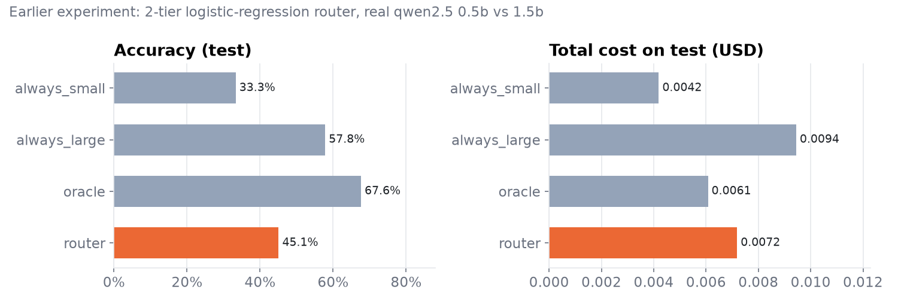

Real `qwen2.5:0.5b` (small) vs `qwen2.5:1.5b` (large) on Ollama, with a logistic-regression router.
Source: `models/2tier/router_report.json`.

| Strategy | Accuracy | Cost (USD) |
|---|---|---|
| always_small | 33.3% | 0.0042 |
| always_large | 57.8% | 0.0094 |
| oracle (perfect router) | 67.6% | 0.0061 |
| router | 45.1% | 0.0072 |

**Say (if asked "what didn't work?"):** "Our first router lost 13 points of accuracy for a 24% saving.
That's not a good trade. The oracle showed a perfect router could beat always-large *and* be cheaper,
so the idea was right but the router was too weak. That led to the current design: LightGBM, kNN
features, calibration, a quality target on τ, and the unsure check with escalation."
